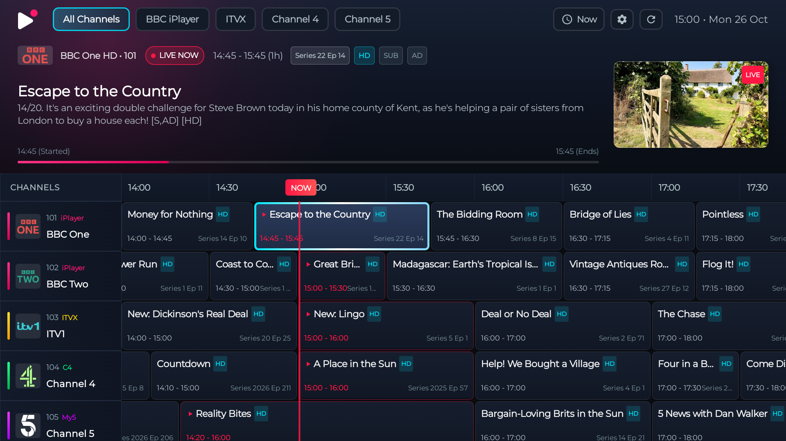
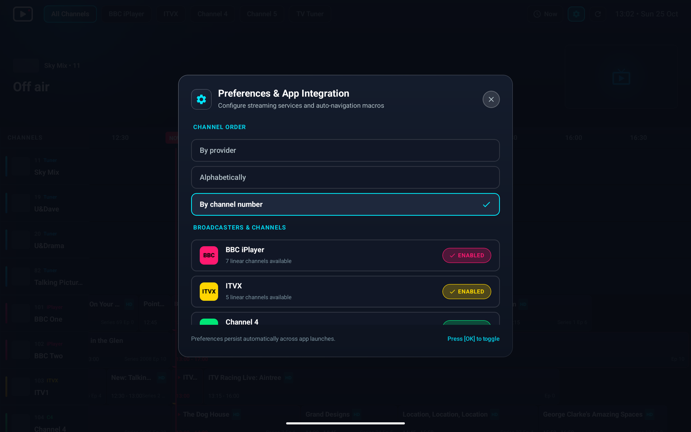

# Live TV for Android TV and Google TV

Live TV is a UK electronic programme guide (EPG) for Android TV and Google TV. Browse current and upcoming programmes, filter by broadcaster, and open supported streams in their broadcaster apps using the remote.

## Screenshots

### EPG guide



### Settings



## Features

- TV remote navigation with a horizontally scrolling programme timeline and a live “Now” marker.
- Programme details, broadcast times, live status, artwork, and available metadata.
- Filters for BBC iPlayer, ITVX, Channel 4, Channel 5 / My5, U / UKTV, and TV Tuner.
- Optional HDHomeRun discovery and tuner streams, with broadcaster-app links preferred for channels available in both places.
- Live listings from Sky's schedule service, with an EPGshare UK XMLTV fallback for channels whose schedule does not cover the next 24 hours.
- Channel order preferences: by channel number, provider, or alphabetically. New installs default to channel number.
- Optional accessibility service for automating navigation in supported broadcaster apps after selecting a live programme.
- Cached programme data to make the guide useful when the network is unavailable.
- Atkinson Hyperlegible typography for clearer letter and number shapes at TV viewing distance.

The XMLTV backup feed is downloaded only when the primary schedule is incomplete and is cached locally for six hours. ITVBe is not included in the backup feed. The font's SIL Open Font License is included at `app/src/main/assets/fonts/Atkinson-Hyperlegible-OFL.txt`.

## Download and install

Download the latest APK from [GitHub Releases](https://github.com/andrewpmoore/LiveTv/releases/latest). Transfer it to the TV and open it with a file manager, or install it over ADB:

To download directly on the TV with Downloader by AFTVnews, enter code **7661331**.

```sh
adb connect <TV_IP_ADDRESS>:5555
adb install -r LiveTv.apk
```

Enable Developer Options and ADB debugging on the TV first. On Google TV Streamer, find these under **Settings → System → About** and **Settings → System → Developer options**.

## Build from source

Requirements: Java 17 and Android SDK 35.

```sh
./gradlew assembleDebug
./gradlew test
```

The debug APK is written to `app/build/outputs/apk/debug/app-debug.apk`.

## Release signing

Release builds use a persistent keystore so Android accepts later APKs as in-place updates. Configure these GitHub Actions repository secrets to use it:

- `ANDROID_KEYSTORE_BASE64`: base64-encoded `.jks` keystore
- `ANDROID_KEYSTORE_PASSWORD`
- `ANDROID_KEY_ALIAS`
- `ANDROID_KEY_PASSWORD`

Create the keystore once, keep a secure backup, and add the encoded keystore and passwords under **Settings → Secrets and variables → Actions** in GitHub. Keep using the same key for every release. If these secrets are incomplete, the workflow builds with a temporary CI debug key instead; Android may require uninstalling that APK before installing a later release signed with the persistent key.

APK releases published before persistent signing used the CI debug key. Android may require uninstalling one of those APKs before installing the first APK signed with the persistent key; if so, enable the Live TV accessibility service again after installing it. Later updates signed with the persistent key retain that setting.
